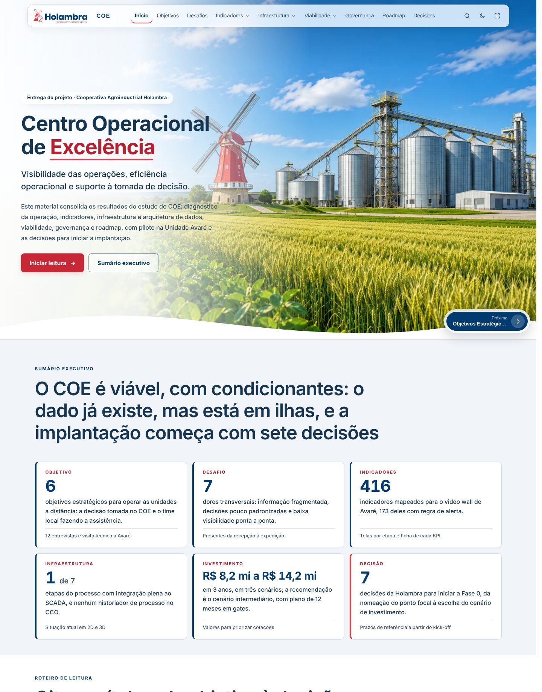

# Painel COE Holambra

Painel do desenho do **Centro Operacional de Excelência da Cooperativa Agroindustrial Holambra**, com piloto na Unidade Avaré. Reúne objetivos, desafios, indicadores, infraestrutura, estudo de viabilidade, governança e roadmap.

A abertura foi revisada como apresentação executiva: título e subtítulo diretos, sem contadores, com um índice de 11 temas. Os objetivos estão consolidados e os desafios seguem uma leitura vertical, com campos explícitos para complementação. A seção de viabilidade permanece acessível e intacta, fora desta revisão. As **19 páginas em 8 seções**, os **416 indicadores**, a planilha, as fotos, os gráficos, os modelos 3D e o videowall continuam no mesmo projeto.

> O conteúdo inclui estudo corporativo classificado como restrito. Um repositório privado não protege uma hospedagem pública. Esta entrega prepara os arquivos e não publica o painel. Para disponibilização externa, use uma hospedagem com controle de acesso e a autorização responsável pelo conteúdo.



## Executar localmente

Para **visualizar**, não há dependências de produção nem instalação de pacotes. Pode abrir `index.html` diretamente. Para desenvolvimento e comportamento consistente de origem/localStorage, prefira HTTP local:

```powershell
python -m http.server 8000 --bind 127.0.0.1
```

Abra [http://127.0.0.1:8000](http://127.0.0.1:8000). Encerre o servidor com `Ctrl+C`. Esse servidor é para desenvolvimento, não para produção.

Para clonar após criar o repositório:

```powershell
git clone <URL-DO-REPOSITORIO-PRIVADO>
cd coe-holambra-main
```

## Gerar e atualizar

**Python 3.10 ou superior**, apenas biblioteca padrão. Validado localmente com Python 3.13.7. Não é necessário `pip install`, Node ou npm para gerar o painel.

```powershell
python atualizar.py
```

Esse é o **build de produção** do projeto: gera `index.html`, `js/indicadores.js` e `js/viabilidade-dados.js`. Esses três arquivos precisam ficar versionados, pois permitem abrir o painel sem Python. Não há bundle, pasta `dist/` ou compilação de framework.

O gerador seleciona a maior versão numérica do CSV (`1.10` vem depois de `1.9`), lê os valores calculados do XLSX, valida IDs, rotas, marcadores e recursos locais e só então substitui as saídas. As substituições são atômicas por arquivo; não constituem uma transação de diretório. Antes de trocar um XLSX, recalcule e salve a planilha no Excel/LibreOffice: Python não calcula fórmulas.

| Alteração | Fonte correta |
| --- | --- |
| Home | `fonte/paginas/00-01-objetivo-do-coe.html`, `css/home.css`, `js/home.js`, `js/home-media.js` |
| Imagens da home | `img/home/`; nomes usados em `js/home-media.js` |
| Texto e imagens das demais páginas | `fonte/paginas/` |
| Ordem, rotas e grupos | `fonte/etapas.json` |
| Navegação, busca, KPIs, tema | `js/painel.js` |
| Estilos e identidade compartilhada | `css/painel.css`, `css/componentes.css` |
| Indicadores | Novo CSV versionado em `fonte/mapeamento/` |
| Viabilidade | `Viabilidade/COE_Holambra_Estudo_Viabilidade.xlsx` |
| Endereço e composição do videowall | `fonte/videowall.json` |
| Modelos 3D | `holambra-avare-3d/index.html`, `arq3d/index.html`, `js/modelo-host.js` |

**Não edite manualmente os três arquivos gerados.** Depois de mudar fontes, dados ou CSS/JS, execute o gerador para atualizar também os hashes de cache. O cálculo normaliza quebras de linha para que o build seja reproduzível em checkouts Windows e Linux. Há um fragmento histórico `04-05-arquitetura-to-be-em-3d.html` fora de `etapas.json`; foi preservado, sem acrescentar uma rota duplicada.

A identidade foi revista com base no portal institucional e no novo SVG enviado: azul `#003A70`, vermelho `#EF3340`, logotipo vetorial transparente no cabeçalho/rodapé e ícones de traço fino. Dia e noite agora mostram a mesma cena e o mesmo enquadramento. Consulte [a revisão visual](docs/MANUAL.md) para fontes e detalhes.

## Tecnologias e dependências

- HTML5, CSS3 e JavaScript nativo; roteamento por hash, sem servidor de aplicação.
- Python 3.10+ para geração, testes de dados e leitura do CSV/XLSX.
- Three.js **0.128.0 (r128)** e OrbitControls **0.128.0**, carregados por CDN com verificação SRI.
- Plus Jakarta Sans por Google Fonts, com fontes de sistema como fallback. Os modelos mantêm suas fontes originais.
- Imagens responsivas WebP na home; fotos originais e miniaturas locais preservadas. O herói solicita só a variante necessária e os recursos fora de tela usam carregamento tardio.
- Apenas para testes opcionais: Node.js 20+, pnpm **11.25.0**, Playwright **1.56.1** e axe-core **4.11.0**, travados no `pnpm-lock.yaml`.

Não há `.env`, banco, backend, autenticação própria nem endpoints privados implementados. Criar `.env.example` sem variáveis usadas não teria função. Configuração de acesso pertence à hospedagem.

## Testes

Verificações de dados e sintaxe, sem instalar dependências Python:

```powershell
python atualizar.py
python -m unittest discover -s tests -v
node scripts/check-javascript.cjs
```

Para navegador real e acessibilidade, instale as ferramentas opcionais (requer pnpm 11.25.0; se necessário, instale-o com `npm install --global pnpm@11.25.0`):

```powershell
pnpm install --frozen-lockfile --ignore-scripts
pnpm exec playwright install chromium
```

Inicie o servidor em um terminal:

```powershell
python -m http.server 8765 --bind 127.0.0.1
```

Em outro terminal, na raiz do projeto:

```powershell
pnpm run test:browser
pnpm run audit:ui
pnpm audit
```

Os scripts usam `http://127.0.0.1:8765`. `COE_BASE_URL` permite escolher outro servidor. `COE_EVIDENCE_DIR` altera a pasta de capturas/relatórios; o padrão `test-results/` é ignorado pelo Git. Parte dos testes abre modelos com bibliotecas externas: exige internet e suporte WebGL. A auditoria registra falhas externas separadamente e falha se houver erro próprio, recurso local ausente, overflow ou violação WCAG detectada nas páginas verificadas. Uma varredura automática não certifica acessibilidade integral.

O workflow `.github/workflows/validar.yml` gera e verifica os arquivos, executa testes Python em 3.10/3.13 e testes Chromium. Foi revisado localmente; sua execução no GitHub só poderá ser confirmada após o envio ao repositório.

## Funcionalidades e atalhos

- Menu por seção, abas, detalhes recolhíveis e navegação anterior/próxima.
- Busca global por texto e ID; filtros por tela, fornecedor, situação, onda e alerta.
- Mural tático/estratégico com iframes ao vivo, rodízio e telão.
- Fotos ampliáveis, arquitetura 2D/3D, modelo de Avaré, simulador e tabelas da viabilidade.
- Temas claro/escuro, navegação por teclado, foco visível e movimento reduzido.
- `Ctrl+K` ou `/`: busca. Setas esquerda/direita: páginas, quando o foco não está num controle. `F`: tela cheia. `M`: menu móvel. `Escape`: fechar diálogos/menu. Setas cima/baixo: escolher KPI na lista.

**Câmeras do modelo Avaré:** o editor preserva as alterações no `localStorage` do navegador/origem em uso e exporta CSV. O painel informa explicitamente o modo local. Não existe colaboração, login ou banco compartilhado implementado neste repositório. Trocar de porta, navegador ou domínio muda esse armazenamento; exporte antes de migrar.

## Internet e limites operacionais

O conteúdo local funciona sem internet; fontes usam fallback. O videowall depende de [felipeab8.github.io/videowall-coe](https://felipeab8.github.io/videowall-coe/), e os modelos 3D dependem das duas CDNs. O painel trata indisponibilidade sem substituir TVs por imagens. Carregar um iframe não comprova a atualidade nem a correção dos dados do serviço externo.

O catálogo inclui campos “Validar”, simulações e premissas preliminares; a integração preserva esses avisos. Não conectamos sistemas corporativos ou sensores inexistentes no código.

## Estrutura

```text
index.html                 # painel gerado; necessário para execução estática
atualizar.py               # gerador e validação
fonte/                     # modelo, 20 fragmentos, JSON, CSV e leitor XLSX
Viabilidade/               # planilha necessária ao build
css/                       # componentes, painel e home
js/                        # módulos, integração 3D e dados gerados
img/                       # ícones e WebPs da home
dados/                     # fotos e miniaturas
arq3d/                     # arquitetura 3D
holambra-avare-3d/          # modelo Avaré e editor de câmeras
tests/                     # testes Python, Chromium e auditoria
scripts/                   # verificação de sintaxe
docs/                      # diagnóstico, relatório, segurança e manutenção
.github/workflows/         # validação; sem implantação automática
```

## Atualizar o repositório existente

Extraia o ZIP em uma pasta vazia. No clone de `Felipeab8/coe-holambra`, crie uma branch:

```powershell
git switch -c revisao/material-executivo
```

Copie **todo o conteúdo da pasta `coe-holambra-main` do ZIP** para a raiz do clone, preservando a pasta `.git`. Execute:

```powershell
python atualizar.py
python -m unittest discover -s tests -v
git status --short
git diff --stat
git add .
git diff --cached --stat
git commit -m "Revisa apresentação executiva e organiza leitura do material COE"
git push -u origin revisao/material-executivo
```

No GitHub, abra o pull request dessa branch para a branch principal. A entrega não executa commit, push, publicação ou PR automaticamente.

## Criar um repositório novo

Crie um **repositório privado vazio**, sem README automático. Na pasta deste projeto:

```powershell
git init -b main
git add .
git diff --cached --stat
git commit -m "Integra home modernizada ao painel COE Holambra"
git remote add origin <URL-DO-REPOSITORIO-PRIVADO>
git push -u origin main
```

Revise o conteúdo antes do primeiro envio. `.gitignore` exclui credenciais, ambientes reais, `node_modules`, caches, ZIPs e temporários; não exclui os dados e HTML gerados necessários. Não foi adicionado um arquivo LICENSE porque os anexos não concedem uma licença para redistribuição.

Para hospedagem, consulte [Segurança e produção](docs/MANUAL.md). Para o trabalho realizado e resultados reais, veja [Relatório de integração](docs/MANUAL.md), [Diagnóstico e plano](docs/MANUAL.md) e [Inventário das alterações](docs/MANUAL.md).

## Pacote enxuto
A documentação completa está em `docs/MANUAL.md`, e as evidências em `docs/validacao.json`. A home usa duas imagens, sem variantes redundantes. Os estilos são incorporados ao HTML pelo gerador. Extraia esta versão em uma pasta vazia para não misturar arquivos de pacotes anteriores.

## Escopo e validação desta revisão

Foram executados 13 testes Python de geração/leitura de dados, 23 testes de navegador e verificação de sintaxe dos 11 scripts. A auditoria editorial verificou 14 páginas nos dois temas, incluindo abas abertas em celular (66 varreduras axe), 42 combinações de rota/resolução e 12 capturas da abertura. Nenhuma violação automática de acessibilidade, erro JavaScript de página ou recurso local com HTTP 404 foi encontrado no resultado final. Isso não substitui teste de usabilidade ou revisão humana completa de acessibilidade.

Para repetir o escopo editorial, com servidor já iniciado:

```powershell
node --test --test-skip-pattern="return simulator" tests/browser.cjs
$env:COE_SCOPE="editorial"
node tests/audit-ui.cjs
```

O teste específico do simulador foi excluído desta execução. Os testes Python verificam contratos do gerador e do leitor XLSX; não validam conclusões de viabilidade. Os cinco fragmentos, a planilha, os dados gerados e a lógica da viabilidade foram comparados e permanecem intactos.

Pendências: preencher os campos identificados, validar os vínculos entre problemas/KPIs/soluções e realizar teste de usabilidade antes de decidir pela rolagem integral. O iframe do videowall externo ainda solicita `logo-holambra.png` com resposta 404; esse recurso precisa ser corrigido no repositório `videowall-coe`, sem relação com a logo local deste material.
