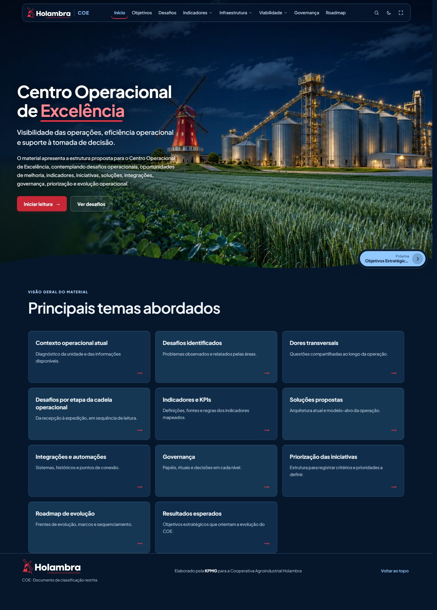
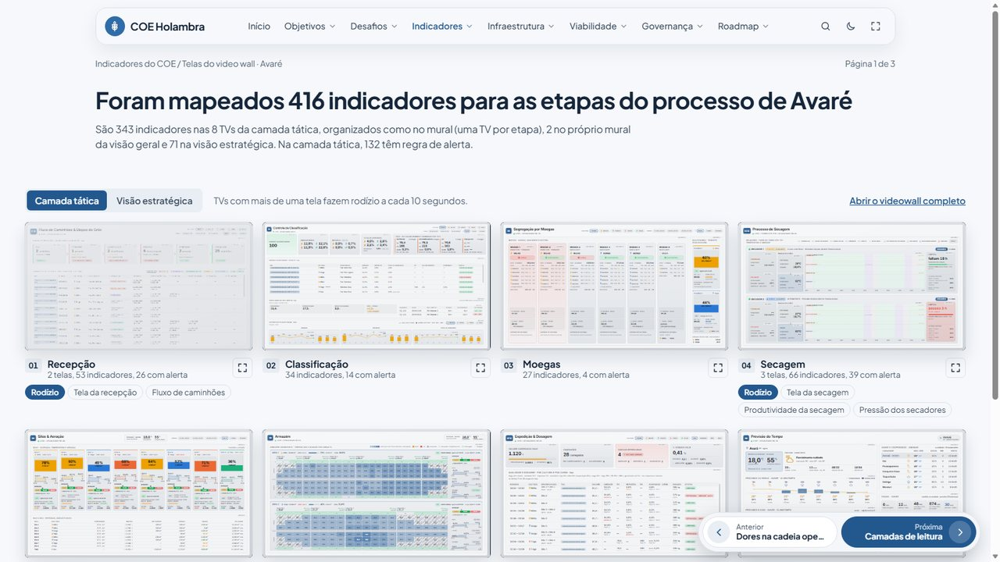
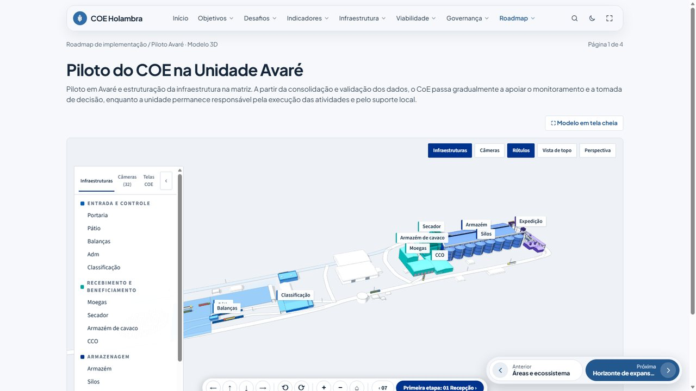
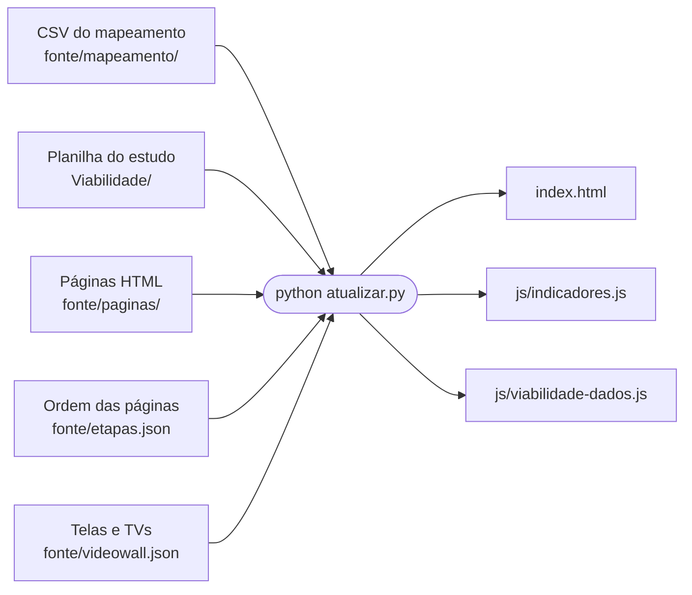

# Painel COE Holambra

Site que reúne, em um só lugar, os entregáveis do desenho do **Centro de Excelência Operacional (COE)** da Cooperativa Agroindustrial Holambra: objetivos, desafios, indicadores, infraestrutura, viabilidade, governança e roadmap. O piloto é a Unidade Avaré.

> [!CAUTION]
> **Conteúdo restrito.** O estudo de viabilidade tem classificação restrita e está em emissão preliminar (revisão A). Mantenha este repositório privado. Não publique o painel, nem ative o GitHub Pages, sem autorização.



## Sumário

- [Como abrir](#como-abrir)
- [O que há no painel](#o-que-há-no-painel)
- [Como o projeto funciona](#como-o-projeto-funciona)
- [Estrutura das pastas](#estrutura-das-pastas)
- [Como atualizar](#como-atualizar)
- [Conteúdo que depende de internet](#conteúdo-que-depende-de-internet)
- [Navegação e atalhos](#navegação-e-atalhos)
- [Regras do projeto](#regras-do-projeto)

## Como abrir

Baixe o repositório e abra `index.html` no navegador, com dois cliques. Não há instalação nem servidor.

```powershell
git clone https://github.com/Felipeab8/coe-holambra.git
cd coe-holambra
start index.html
```

## O que há no painel

São 24 páginas em 8 seções. O menu do topo segue esta ordem. Páginas irmãs ficam em abas e os detalhes longos em seções recolhíveis, para o título e o recado de cada bloco ficarem à vista.

| Seção | Páginas | O que mostra |
| --- | --- | --- |
| Início | 1 | Objetivo do COE e um resumo de todo o site |
| Objetivos | 2 | O que a Holambra espera do COE, a partir de 12 entrevistas e da visita técnica a Avaré |
| Desafios | 1 | Dores relatadas pelas áreas, gerais e por etapa da operação |
| Indicadores | 3 | Mural com as telas do video wall ao vivo, camadas de leitura e ficha de cada KPI |
| Infraestrutura | 7 | Diagnóstico da unidade; física: diagnóstico de campo e soluções, piloto Avaré em 3D, fichas dos equipamentos e sala do COE; software: arquitetura As-Is e To-Be em 2D e 3D, sistemas e históricos |
| Viabilidade | 5 | Situação atual, investimento e retorno, solução e contratação, plano e gates, decisões e próximos passos |
| Governança | 3 | Níveis de decisão, rituais, papéis, equipe de Avaré e áreas envolvidas |
| Roadmap | 2 | Expansão às sete unidades, ondas de implementação e jornada de automação |

| Mural de indicadores | Piloto Avaré em 3D |
| --- | --- |
|  |  |

### Versões das fontes

| Fonte | Versão atual | Alimenta |
| --- | --- | --- |
| Mapeamento de indicadores (CSV) | 1.5v, com 416 indicadores | Mural, ficha de KPI, busca e contagens do site |
| Estudo de viabilidade (planilha) | Revisão A, emissão preliminar | Cenários, fluxo de caixa, priorização, gates, riscos, plano mestre e sala do COE |
| Estudo de viabilidade (Word) | Revisão A, emissão preliminar | Textos das páginas `05-*`, já transcritos para `fonte/paginas/` |

## Como o projeto funciona

O site é montado por um script a partir da pasta `fonte/`. Os arquivos gerados também ficam no repositório, para o painel abrir sem nenhuma etapa prévia.



O `atualizar.py` usa apenas a biblioteca padrão do Python, sem `pip install`. Além de montar o site, ele:

- escolhe o CSV de versão mais alta;
- recalcula todas as contagens exibidas nas páginas;
- para com erro se faltar uma coluna no CSV, um rótulo na planilha, um ID ficar repetido ou uma página não existir;
- avisa quando um indicador fica sem onda;
- versiona os links de CSS e JS, para o navegador não usar arquivos antigos.

## Estrutura das pastas

```text
.
├── index.html                 Site completo (gerado)
├── atualizar.py               Monta o site a partir de fonte/
├── fonte/
│   ├── modelo.html            Esqueleto do site: barra do topo, rodapé, janelas
│   ├── etapas.json            Seções, páginas e sua ordem
│   ├── videowall.json         Endereço e organização das telas e TVs
│   ├── ler_viabilidade.py     Lê a planilha do estudo
│   ├── gerar_paisagem.py      Desenha a ilustração da tela inicial
│   ├── mapeamento/            CSVs do mapeamento de indicadores
│   └── paginas/               Uma página HTML por arquivo
├── Viabilidade/               Planilha do estudo
├── css/
│   ├── painel.css             Layout, navegação e tema
│   └── componentes.css        Cartões, tabelas e diagramas
├── js/
│   ├── painel.js              Navegação, mural, ficha de KPI e busca
│   ├── viabilidade.js         Tabelas e gráficos da seção Viabilidade
│   ├── arquitetura.js         Diagrama de arquitetura
│   ├── indicadores.js         Dados dos indicadores (gerado)
│   └── viabilidade-dados.js   Dados do estudo (gerado)
├── holambra-avare-3d/         Modelo 3D da Unidade Avaré
├── arq3d/                     Modelo 3D da arquitetura To-Be
├── dados/                     Imagens das fichas por sistema e fotos do diagnóstico
├── img/                       Ícones e imagens da cadeia operacional
└── docs/capturas/             Imagens deste README
```

Os arquivos das páginas têm número no nome, mas quem define a ordem no site é o `fonte/etapas.json`.

## Como atualizar

Depois de qualquer mudança em `fonte/` ou em `Viabilidade/`, rode:

```powershell
python atualizar.py
```

Não edite à mão `index.html`, `js/indicadores.js` nem `js/viabilidade-dados.js`: eles são regravados a cada execução.

| Para mudar | Mexa em |
| --- | --- |
| Mapeamento de indicadores | Coloque o CSV novo em `fonte/mapeamento/`. O de versão mais alta é usado (`..._1.6v.csv`), e todas as contagens se recalculam. |
| Estudo de viabilidade | Coloque a planilha nova em `Viabilidade/`. Cenários, fluxo de caixa, priorização, roadmap, gates, plano mestre (aba 01) e sala do COE (aba 02) se atualizam sozinhos. Textos vindos do Word ficam nas páginas `05-*`. |
| Texto de uma página | O arquivo dela em `fonte/paginas/`. |
| Resumo da tela inicial | O bloco "O que você vai ver neste site" em `fonte/paginas/00-01-objetivo-do-coe.html`. É escrito à mão: revise se uma seção mudar de conteúdo. |
| Nova página ou ordem das páginas | `fonte/etapas.json` e o arquivo em `fonte/paginas/`. O campo `palavra` é o nome curto no menu. O campo opcional `grupo` vira coluna no menu suspenso; páginas do mesmo grupo devem ficar em sequência. |
| Telas e TVs do mural | `fonte/videowall.json`. Uma tela nova no CSV precisa do código aqui; se faltar, o `atualizar.py` avisa. |
| Visual | `css/painel.css` (layout) e `css/componentes.css` (componentes). |
| Ilustração da tela inicial | Cores: variáveis `--ps-*` em `css/painel.css`, uma paleta por tema. Desenho: `python fonte/gerar_paisagem.py fonte/paginas/00-01-objetivo-do-coe.html`, depois `python atualizar.py`. |

Para registrar a mudança no GitHub:

```powershell
git add .
git commit -m "Descreva o que mudou"
git push
```

## Conteúdo que depende de internet

O painel abre offline, mas estes itens só carregam conectado:

| Item | De onde vem |
| --- | --- |
| Telas do video wall | Ao vivo, em iframe, de [felipeab8.github.io/videowall-coe](https://felipeab8.github.io/videowall-coe/). Não são capturas: clique em uma tela para abri-la e usar os filtros. |
| Modelos 3D | Bibliotecas carregadas de CDN (jsDelivr e cdnjs) |
| Fonte Plus Jakarta Sans | Google Fonts |

## Navegação e atalhos

Os botões **Anterior** e **Próxima** ficam fixos no canto inferior direito, em qualquer ponto da rolagem.

| Tecla | Ação |
| --- | --- |
| Setas para esquerda e direita | Página anterior e próxima |
| `Ctrl K` ou `/` | Busca |
| `F` | Tela cheia |
| `M` | Abrir o menu em telas menores |

## Regras do projeto

- **Sigilo:** repositório privado, e nada de publicar o painel sem autorização. Se o repositório virar público, o histórico inteiro fica exposto, incluindo a planilha.
- **Documento Word:** o Word do estudo fica fora do repositório, porque nenhum script o utiliza. Ele não deve ser adicionado sem necessidade. A regra está no `.gitignore`.
- **Telas sempre ao vivo:** as telas do video wall entram por iframe, nunca como imagem.
- **Fotos de campo:** confira uma a uma antes de usar. Não publique imagens em que apareçam pessoas identificáveis.
